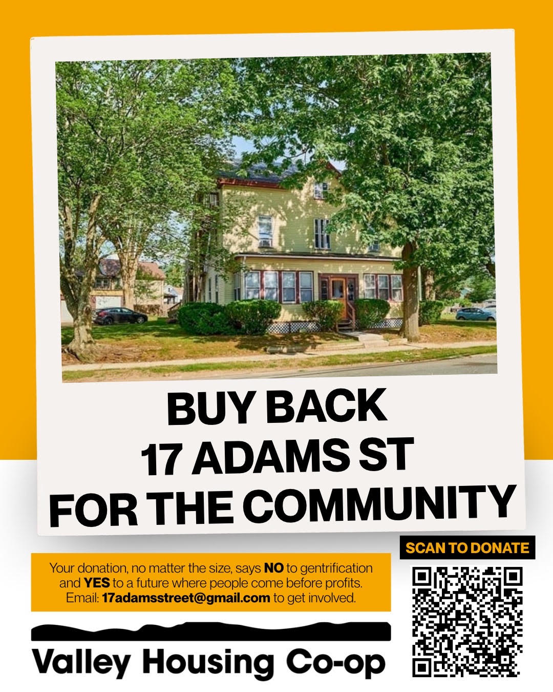

Valley Housing Coop is located in Greenfield MA, leasing 25 acres from [Valley Community Land Trust](www.vclt.org) with 2 duplexes. We have plans for future housing development and acquisition to become a scatter site housing cooperative. 

## We are growing!!

Support the 17 Adams St tenants association in Easthampton to buy their building from a private equity investor with the help of Valley Housing Coop! We are fundraising $400,000 to close by March 31st. Please support this project to show that tenant power can win and we can keep our communities affordable.    

[Please read more and make a tax deductible donation](https://www.zeffy.com/en-US/donation-form/buy-back-17-adams-street-for-the-community-2) thanks to our fiscal host (Warren J Plaut Charitable Trust). You can also help by passing this along this story to friends! THANK YOU!

We envision a world in which housing is a right, not a commodity, and land is returned to the commons to be collectively stewarded for generations to come.

Our mission is to grow the movement for permanently affordable cooperatively owned housing and land for the benefit of our communities.

Our Aims:

- **[Membership:](mailto:membership@valleyhousing.coop)** Supporting transparent democratic governance through effective communication systems for members. Sharing what we learn to inspire others as part of a broader movement.
- **[Housing Infrastructure:](mailto:housing-infra@valleyhousing.coop)** Maintaining and improving existing homes to be more sustainable and provide a better quality of life for residents.
- **[Land Stewardship:](mailto:land-stewardship@valleyhousing.coop)** Stewarding the land and relationships to the commons for the benefit of the community, ecosystem, and inhabitants.
- **[Development:](mailto:development@valleyhousing.coop)** Expanding the portfolio of Valley Housing Coop and aligned groups like Community Land Trusts to support self determined safe housing and remove land from the real estate market.
- **[Finance:](mailto:finance@valleyhousing.coop)** Managing and planning the co-op’s finances to ensure future stability and fair distribution of wealth. Mobilizing capital to support our mission.

## Get Involved

[Become a community member owner](https://forum.valleyhousing.coop/signup) to receive updates, have the option to participate in governance, and read community discussions.

Reach out to one of the circle's above if you are interested in their area, or reach out to [membership@valleyhousing.coop](mailto:membership@valleyhousing.coop) for general inquiries.  

Follow on Instagram @valleyhousing.coop

[Read our blog](https://forum.valleyhousing.coop/c/public/blog/37) for news and updates.

